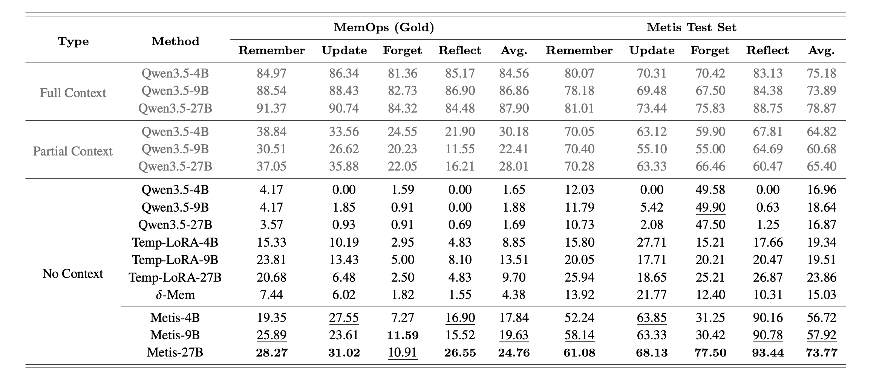

<div align="center">
  <picture>
    <source media="(prefers-color-scheme: dark)" srcset="assets/metis_hero_dark.svg">
    <source media="(prefers-color-scheme: light)" srcset="assets/metis_hero_light.svg">
    
  </picture>

  <p>
    <a href="https://arxiv.org/abs/2607.26760"></a>
    <a href="https://huggingface.co/collections/IAAR-Shanghai/metis"></a>
  </p>

  <p>
    <a href="https://arxiv.org/abs/2607.26760">论文</a> ·
    <a href="#项目简介">项目简介</a> ·
    <a href="#快速开始">快速开始</a> ·
    <a href="#训练">训练</a> ·
    <a href="#评测">评测</a> ·
    <a href="#引用">引用</a>
  </p>

  <p align="center">
    <a href="README.md">English</a> | <strong>中文</strong>
  </p>
</div>

> [!IMPORTANT]
> **研究预览版。** 本仓库提供 Metis 架构、数据格式文档、推理示例、多步中期训练与评测框架，以及官方模型权重。训练数据尚未包含在内。

## 💡项目简介

**Metis 是首个记忆基础模型（Memory Foundation Model）原型，为基础模型赋予持久且动态演化的原生记忆状态。**

Metis 学习通过模型计算自主存储和使用信息，将历史上下文压缩到原生记忆中，并通过记忆注意力访问这些信息。在推理期间，所有模型权重保持冻结，记忆则通过无梯度的前向计算进行更新。


本项目探索三个核心理念：

- **原生记忆状态。** 动态参数状态位于 Backbone 内部，并直接参与后续的前向计算。
- **原生记忆过程。** 信息的存储与使用由数据驱动学习获得，而不是通过独立的检索、重排和 Prompt 构造规则实现。
- **固定大小的会话状态。** 历史信息被压缩到紧凑状态中，因此后续查询无需重新回放原始文本历史。

### 模型架构

每个 **Metis Block** 被插入 Transformer 层中，并包含两个组件：

- **Local Memory Block** 维护跨交互步骤持续存在的动态记忆矩阵与归一化状态。
- **Hyper Memory Block** 学习 Token 选择、记忆 Key/Value 投影、独立的记忆 Query 以及状态更新过程。

每次记忆步骤完成后，Metis 会选择具有信息量的隐藏状态并更新 Local Memory。后续查询时，记忆注意力读取该状态，并将结果与原始注意力分支融合。默认实现使用 **Gated Delta Network（GDN）** 进行更新。在 Qwen3.5 混合架构实现中，Metis 接入 Full-Attention 层，而 Linear-Attention 层保持原有计算路径。

### 评测结果

记忆操作任务的总体表现。




## 🚀 快速开始

### 1. 创建环境

```bash
conda env create -f environment.yml
conda activate metis
```

### 2. 运行推理

从 Metis delta 或完整 Checkpoint 运行推理：

```bash
bash infer.sh /path/to/checkpoint \
  --prompt "Hello" \
  --max_new_tokens 128
```

如需进行记忆跨轮持久化的多轮推理，请重复传入 `--prompt`。使用 JSON 文件时，每个顶层条目都被视为一个独立会话：

```bash
python run_inference.py \
  --checkpoint_path /path/to/checkpoint \
  --prompt "Please remember that my launch code is ORION-73." \
  --prompt "What launch code did I tell you?" \
  --commit_mode exchange
```


如需从 JSON 文件运行多个相互独立的多轮会话，请使用
`--questions_file`：

```bash
python run_inference.py \
  --checkpoint_path /path/to/checkpoint \
  --questions_file example/multi_turn_questions.json \
  --commit_mode exchange \
  --output_jsonl outputs/multi_turn_questions.jsonl
```

`--commit_mode none` 保持记忆不变，`--commit_mode user` 仅写入用户消息，`--commit_mode exchange` 则同时写入用户消息和模型回复。

### 运行时记忆生命周期

```python
model.reset()

# 将一次交互写入原生记忆状态。
model(
    **memory_inputs,
    commit_memory=True,
    use_cache=False,
    logits_to_keep=1,
)

# 查询时无需重新回放原始记忆文本。
answer_ids = model.generate(
    **query_inputs,
    max_new_tokens=32,
    do_sample=False,
)

# 开始一个新的独立会话。
model.reset()
```

## 数据格式

Metis JSONL 数据集的每一行包含一个对象。`messages` 是一个交互块列表，每个交互块都是一组对话消息；`query_turn_id` 指定哪个交互块的最后一条 assistant 回复参与损失计算。

```json
{
  "sample_id": "sample-001",
  "messages": [
    [
      {"role": "user", "content": "Remember that my code name is Polaris."},
      {"role": "assistant", "content": "I will remember it."}
    ],
    [
      {"role": "user", "content": "What is my code name?"},
      {"role": "assistant", "content": "Your code name is Polaris."}
    ]
  ],
  "query_turn_id": 1,
  "metadata": {"type": "remember", "style": "explicit"}
}
```

## 🏋️ 训练

### 1. 准备数据集

<!-- Metis 训练数据集可从 **[链接待发布]** 下载。 -->
按照上述 JSONL 格式分别准备训练集和验证集。

### 2. 对数据集进行分词

使用目标 Backbone 的 Tokenizer 对训练集和验证集进行预分词：

```bash
python scripts/tokenize_dataset.py \
  --data_dir /path/to/metis-dataset/train \
  --output_dir /path/to/tokenized/train \
  --model_path /path/to/backbone \
  --max_total_tokens 1024

python scripts/tokenize_dataset.py \
  --data_dir /path/to/metis-dataset/valid \
  --output_dir /path/to/tokenized/valid \
  --model_path /path/to/backbone \
  --max_total_tokens 1024
```

默认包含所有训练任务。如需有意替换已有的分词缓存，请添加 `--overwrite`。

### 3. 启动训练

使用预分词数据的最简运行命令如下：

```bash
bash scripts/train.sh \
  --model-path /path/to/backbone \
  --name metis-run \
  --train-data /path/to/tokenized/train \
  --valid-data /path/to/tokenized/valid
```

启动器会冻结 Backbone、禁用 LoRA，并训练原生记忆参数。完整的参数说明、默认值、验证控制项和任务调度记录在 [`scripts/train.sh`](scripts/train.sh) 中；运行 `bash scripts/train.sh --help` 可查看命令行接口。

默认的记忆配置为：

```text
NormedReweightLearnedQueryMetisBlock
+ StraightThroughAlphaTopPGatedDeltaRuleMetisHyperMemory
+ NormalizedDeltaNetMetisLocalMemory
```

在启动命令后追加以下任一选项，可切换 Hyper Memory 变体：

```text
# Last-token gated-delta 更新。
--metis-hyper-memory-type LastTokenGatedDeltaRuleMetisHyperMemory

# 使用 AlphaTopP Token 选择，但不使用 gated-delta 更新。
--metis-hyper-memory-type StraightThroughAlphaTopPKeyNormMetisHyperMemory
```

`--metis-block-type`、`--metis-hyper-memory-type` 和 `--metis-local-memory-type` 可以组合使用，以分别研究 Block 融合、Token 聚合/更新和 Local State 变体。

常用的优化与验证控制项通过环境变量设置。例如，以下命令复现了一个 4 GPU Qwen3.5-4B 实验的主要配置：每个设备的 Batch Size 为 4、梯度累积为 2、训练三个 Epoch，并使用 Last-Token Gated-Delta 记忆更新（有效 Batch Size 为 32）：

```bash
LR=2e-4 NUM_EPOCHS=3 \
bash scripts/train.sh \
  --model-path /path/to/Qwen3.5-4B \
  --name metis-qwen35-4b-agg-lta-gdu-4gpu-bs4-ga5-3ep \
  --train-data /path/to/tokenized/train \
  --valid-data /path/to/tokenized/valid \
  --backbone-type qwen3_5 \
  --cuda-visible-devices 0,1,2,3 \
  --nproc-per-node 4 \
  --batch-size 4 \
  --grad-accum 5 \
  --metis-hyper-memory-type LastTokenGatedDeltaRuleMetisHyperMemory
```

## 📊 评测


## 路线图


论文将原生记忆的发展描述为从 **状态化能力（Stateful Capability）** 到 **自管理记忆（Self-Managing Memory）**、**经验驱动学习（Experience-Driven Learning）**、**持久认知（Persistent Cognition）**，最终达到 **自演化能力（Self-Evolving Capability）** 的渐进过程。

Metis 仍是一个早期研究系统，并非对外部记忆的完整替代。原生记忆与外部记忆相结合的混合系统仍是重要研究方向。


## 📝 引用

仓库根目录包含机器可读的 `CITATION.cff`。

```bibtex
@misc{zhang2026metis,
  title        = {Metis: Memory Foundation Model},
  author       = {Zhang, Zeyu and Guo, Ziliang and Sun, Yihang and Zhang, Xichong and
                  Hao, Xixuan and Lin, Zehao and Zhang, Yang and Zhao, Xiaoyan and
                  Shen, Tong and Tang, Bo and Xu, Zhi-Qin John and Yan, Junchi and
                  Wang, Haofen and Chen, Xu and Xiong, Feiyu and Li, Zhiyu and
                  Chua, Tat-Seng},
  year         = {2026},
  howpublished = {Technical report}
}
```

## ⚖️ 许可证

本项目对论文与仓库软件分别采用以下许可证：

- **论文：** Metis 技术报告及原创论文材料采用 [Creative Commons Attribution-NonCommercial-ShareAlike 4.0 International（CC BY-NC-SA 4.0）](LICENSE-PAPER) 许可证。
- **仓库软件：** 本仓库源代码采用 [PolyForm Noncommercial License 1.0.0](LICENSE) 许可证。

PolyForm Noncommercial License 不允许将本仓库软件用于商业用途。如需获得商业使用许可，请联系作者。

除非另有明确说明，模型权重、数据集、评测资源、商标及第三方材料不属于上述许可证的覆盖范围；其适用条款将在对应资源发布时另行说明。

## 📬 联系方式

研究联系邮箱：[lizy@memtensor.cn](mailto:lizy@memtensor.cn) 和 [xu.chen@ruc.edu.cn](mailto:xu.chen@ruc.edu.cn)。
